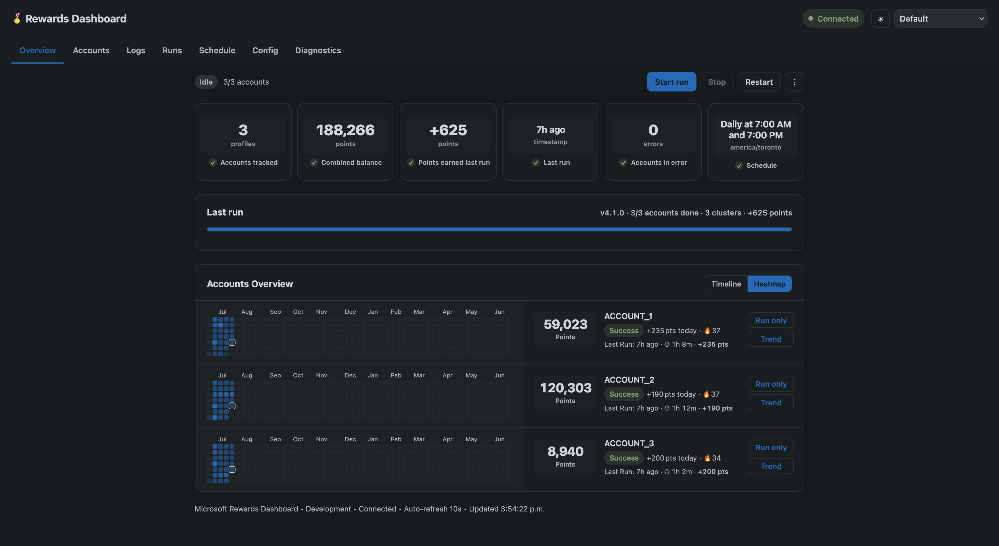
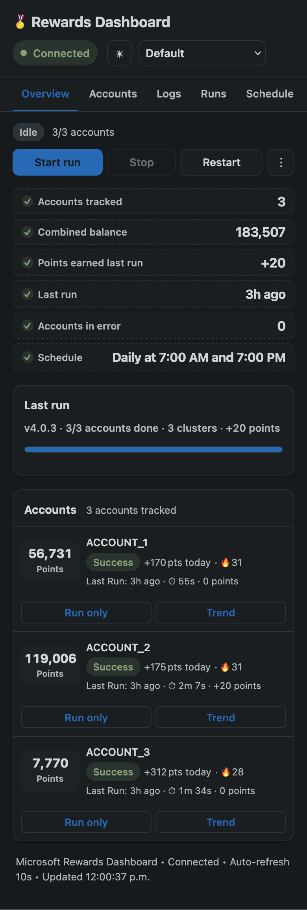

**English** | [简体中文](./README.md)

# Rewards Dashboard (Simplified Chinese / i18n fork)

[](https://github.com/zPan2327/rewards-dashboard-i18n/releases)
[](./LICENSE)

A **Simplified Chinese / multilingual (i18n) fork** of
[`mgrimace/rewards-dashboard`](https://github.com/mgrimace/rewards-dashboard).

On top of the original it adds a complete internationalization layer, built to keep
following upstream without re-translating anything:

- The English original is fully preserved, and **Simplified Chinese is the default
  interface language** — switch back to English from the header, where the UI behaves
  exactly like upstream;
- Simplified Chinese covers **every** interface string, including the 13 theme names and
  all status labels; your choice is **remembered** (reloads and browser restarts keep it);
- Chinese wording was rewritten for the real "dashboard + Microsoft Rewards" context, with
  one consistent glossary across the whole project;
- Every UI string lives in a **language resource addressed by stable translation keys** —
  business code never hard-codes a language;
- Missing translations **fall back to English**, so `undefined` or blank text can never
  reach the screen;
- Ships with a **translation self-check tool** that shows, right after an upstream sync,
  which strings are new and which keys have mismatched placeholders;
- Keeps a small, independent **Chinese log-parsing patch** in `lib/parser.js` so the
  overview tab can read Chinese bot logs (unrelated to i18n): see
  [docs/parser-zh.md](./docs/parser-zh.md);
- **Nothing else is changed**: API paths and request/response shapes, authentication,
  data handling, scheduler/cron, bot control and the Docker deployment all stay exactly
  as upstream.

> The documents under `docs/` are written in Chinese. This file is the English guide
> for this fork; the Chinese original is [README.md](./README.md).

---

## Screenshots

| Desktop | Mobile |
| --- | --- |
|  |  |

*(Screenshots show the English UI; the Chinese UI uses the same layout with translated labels.)*

---

## Quick start (Docker)

### Option 1 — clone and build locally (recommended)

```bash
git clone https://github.com/zPan2327/rewards-dashboard-i18n.git
cd rewards-dashboard-i18n

# Docker network shared with the bot container (ignore "already exists")
docker network create rewards 2>/dev/null || true

# Same Control API token as on the bot side
cp .env.example .env
vi .env                      # API_TOKEN=...

docker compose up -d --build
```

Open `http://<host-ip>:8890`.

### Option 2 — fetch the sources into an existing directory

```bash
mkdir rewards-dashboard-i18n && cd rewards-dashboard-i18n
docker network create rewards 2>/dev/null || true
curl -fsSL https://raw.githubusercontent.com/zPan2327/rewards-dashboard-i18n/main/compose.yaml -o compose.yaml
cp .env.example .env 2>/dev/null || printf 'API_TOKEN=your-token\n' > .env
# compose.yaml builds from ./rewards-dashboard, so the sources are needed too
git clone --depth 1 https://github.com/zPan2327/rewards-dashboard-i18n.git src
cp -r src/rewards-dashboard .
docker compose up -d --build
```

### Option 3 — use the prebuilt image

The release workflow publishes a multi-arch image to GitHub Container Registry:

```bash
docker pull ghcr.io/zpan2327/rewards-dashboard-i18n:latest
```

> [!IMPORTANT]
> GHCR packages are **private** by default. This repository's package is already public;
> if you fork it, switch yours manually:
> `GitHub → your avatar → Packages → rewards-dashboard-i18n → Package settings → Change visibility`.
> Otherwise an anonymous `docker pull` will fail.

Available tags:

| tag | Notes |
| --- | --- |
| `latest` | Always points at the newest release |
| `v2.0.1-i18n.1` | **Current recommendation**: Simplified Chinese by default, translated theme names, all status labels present |
| `v2.0.0-i18n.1` | Previous release: based on upstream v2.0.0 (supports Rewards Script v4/v5); usable for rollback |
| `v1.3.6-i18n.3` | Old release: based on upstream v1.3.6; rollback only |

The full tag list is on the [Releases](https://github.com/zPan2327/rewards-dashboard-i18n/releases) page.

For the full diff against the previous release — the 23 upstream commits, the 82 new
strings, the deployment changes — see **[docs/CHANGELOG-v2.0.0.md](./docs/CHANGELOG-v2.0.0.md)**
(Chinese). The `v2.0.1-i18n.1` delta (Chinese default, translated theme names, status
labels) is section 8 of the same document.

---

## Bot-side requirements

Enable the Control API on `microsoft-rewards-script`:

```yaml
environment:
  API_MODE: "true"
  API_TOKEN: "<a sufficiently long random string>"   # must equal this project's API_TOKEN
  API_ALLOW_CONFIG_WRITE: "true"                     # let the dashboard edit the bot config
  API_ALLOW_SCHEDULE_WRITE: "true"                   # let the dashboard edit the bot schedule
  API_ALLOW_CONFIG_REVEAL: "true"                    # let the dashboard read/edit tokens (v2.0.0+)
```

> [!CAUTION]
> Since v2.0.0 the dashboard can read and write sensitive values such as `API_TOKEN` and
> proxy passwords. Only enable `API_ALLOW_CONFIG_REVEAL` if you really need it, and make
> sure the dashboard itself is behind authentication first.

Both containers must be able to reach each other: put them on the same Docker network
(this project's `compose.yaml` already joins the external `rewards` network), or copy the
service into the bot's own `compose.yaml` — see
[`sample-stack-compose.yaml`](./sample-stack-compose.yaml).

---

## Upgrading from v1.3.6 to v2.0.0

Upstream v2.0.0 is a major release: it still supports Rewards Script v4 and adds support
for the v5 configuration keys (the `config` tab greys out options that do not apply to the
detected bot version and labels them `v5 only` / `v4 only`). This fork merged the full
upstream diff and kept every Chinese string plus the `lib/parser.js` Chinese log patch.

```bash
git pull
docker compose build --pull
docker compose up -d
```

If you use the GHCR image instead, point `image:` at `v2.0.0-i18n.1` (or newer) and run
`docker compose up -d`. Dashboard data (`./data`) and `CONTROL_API_URL` /
`CONTROL_API_TOKEN` need no changes.

---

## Switching languages

The language picker sits in the top-right corner, next to the theme picker:

| Option | Notes |
| --- | --- |
| `简体中文` | **Default language** — complete Chinese translation, including theme names and status labels |
| `English` | The original English UI, identical to upstream (theme names stay in English) |

The choice is stored in the browser's `localStorage` (key `rewards-dashboard:locale`).
Switching is immediate — no reload needed. To go back to the default, clear that key (or
open a private window).

> A browser that already saved `English` keeps English: a remembered choice always wins
> over the default.

---

## How it works

All UI text is extracted into language resources; the code only refers to **keys**:

```
rewards-dashboard/
├── public/i18n/
│   ├── index.js              runtime: t() / tp() / setLocale() / applyI18n() …
│   ├── cronText.js           rewrites English cron descriptions from the Control API
│   └── locales/
│       ├── en.js             English source — the authoritative list of every key
│       └── zh-CN.js          Simplified Chinese translation
└── tools/
    └── i18n-check.mjs        translation self-check tool
```

- Lookup order: **current locale → English → the key itself**, so a missing translation
  shows English rather than an empty string or `undefined`;
- Keys look like `namespace.key` and are **identity, not copy** — reworded English keeps
  the same key, and existing translations stay valid;
- Plural forms (`{ one, other }`) and `{param}` interpolation are supported;
- In English mode date formatting is left completely alone (byte-identical output to the
  pre-i18n dashboard); only other locales are handed to `Intl`.

The full design notes, glossary and upstream-sync workflow are in
**[docs/i18n.md](./docs/i18n.md)** (Chinese), and the Chinese log-parsing patch —
symptom, root cause, changes, verification data — in
**[docs/parser-zh.md](./docs/parser-zh.md)** (Chinese).

### Self-check tool

```bash
cd rewards-dashboard
node tools/i18n-check.mjs          # human-readable report
node tools/i18n-check.mjs --strict # also fail on unused keys
```

It reports `ENGLISH FALLBACK` (missing Chinese — the UI would show English), `UNKNOWN t()
KEY` (used in code but absent from the dictionary), `PLACEHOLDER MISMATCH`, `ORPHAN`,
`EMPTY VALUE`, `PLURAL VARIANT MISSING` and `UNUSED KEY`.

---

## Chinese log-parsing patch

When the bot runs the `V4-china` branch of `microsoft-rewards-script` (fully Chinese
logs), upstream's `lib/parser.js` — which only understands English — cannot parse a single
line, so the overview tab stays empty. This fork patches it so every regex accepts both
English and Chinese spellings.

- Only `lib/parser.js` is touched;
- After an upstream merge, one `grep` confirms the patch survived:

```bash
grep -c "开始处理账户" rewards-dashboard/lib/parser.js    # 0 means the patch was lost
```

Full write-up: **[docs/parser-zh.md](./docs/parser-zh.md)** (Chinese).

---

## Other local adaptations

Besides the Chinese strings and the log patch, this fork carries three small differences
from upstream, all preserved when merging:

| Change | Why |
| --- | --- |
| `public/vendor/phosphor/` bundles the icon font | Upstream loads Phosphor from `unpkg.com` at runtime. The account status rail is **icon-only**, so a blocked or slow CDN makes the status invisible. The v2.1.1 CSS + woff2 (~220 KB) are bundled instead — it works offline. |
| `server.js` MIME map gains `woff2/woff/ttf` | The static server returned fonts as `application/octet-stream`, which Chromium refuses to load, leaving every icon blank. |
| Footer version follows the locale, and `runAccountMap` tolerates a missing status | After switching language the footer stayed English; on the first frame, before `status` arrived, the overview threw `Cannot read properties of null`. Both are small leftover upstream v2.0.0 bugs. |

When updating the bundled icons, overwrite `public/vendor/phosphor/` with the `style.css`
and `Phosphor.woff2` of the same version.

---

## Following upstream

The whole point of this fork: **an upstream release must not require re-translating the UI**.

```bash
git remote add upstream https://github.com/mgrimace/rewards-dashboard.git
git fetch upstream --tags

# The baseline is v2.0.0: the i18n commits were rebased onto upstream v2.0.0,
# so upstream is a real ancestor and future merges are normal three-way merges.
git merge upstream/v2.1.0        # use the actual new tag

cd rewards-dashboard
node tools/i18n-check.mjs        # shows which keys are still missing
```

> Before merging, skim what upstream changed: `git log --oneline v2.0.0..upstream/v2.1.0`.
> If it only adds features and leaves `views/` alone, you usually just add a few entries to
> `zh-CN.js`. If it rewrites a view (as v2.0.0 did for the accounts page), follow the
> upstream structure and re-add the `t()` calls — exactly what the v2.0.0 upgrade did.

| Upstream change | What you do |
| --- | --- |
| Reworded an English string | **Nothing** — the translation keeps working |
| Added a UI string | Add **one** entry to `zh-CN.js` (shows English until then) |
| Added a config option | **Nothing** — the config tab falls back to the English label in code |
| Removed a feature | Delete the stale keys (the checker reports `UNUSED KEY`) |

Detailed workflow: section 7 of [docs/i18n.md](./docs/i18n.md) (Chinese).

---

## Security notes

- `.env` and `data/` (the SQLite database) are in `.gitignore` and **never committed**;
- The repository contains no real `API_TOKEN`, webhook URL, account email or proxy
  credential;
- The dashboard only exposes port `8890` — restrict it with a firewall or a reverse proxy;
- Always set a strong `API_TOKEN` on the Control API.

---

## Credits & license

- Upstream project: [mgrimace/rewards-dashboard](https://github.com/mgrimace/rewards-dashboard)
- Companion bot: [thenetsky/microsoft-rewards-script](https://github.com/thenetsky/microsoft-rewards-script)
- This fork keeps the upstream [MIT License](./LICENSE).
